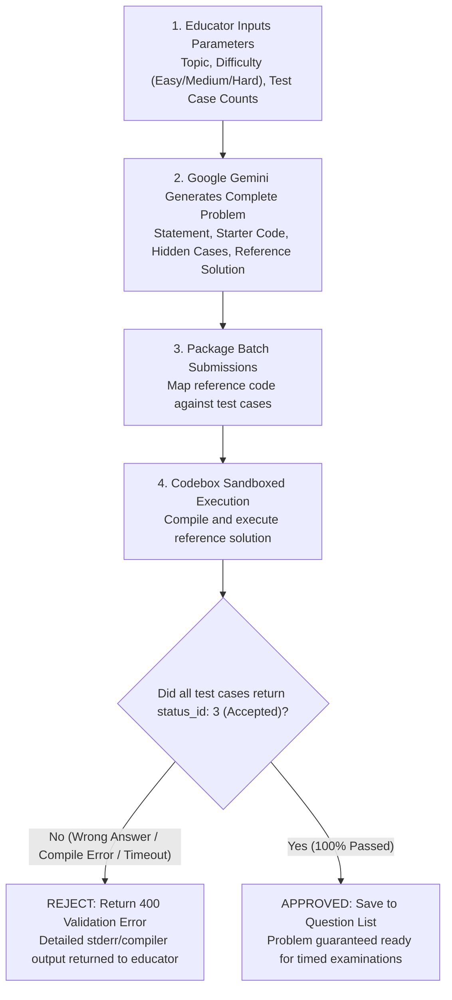
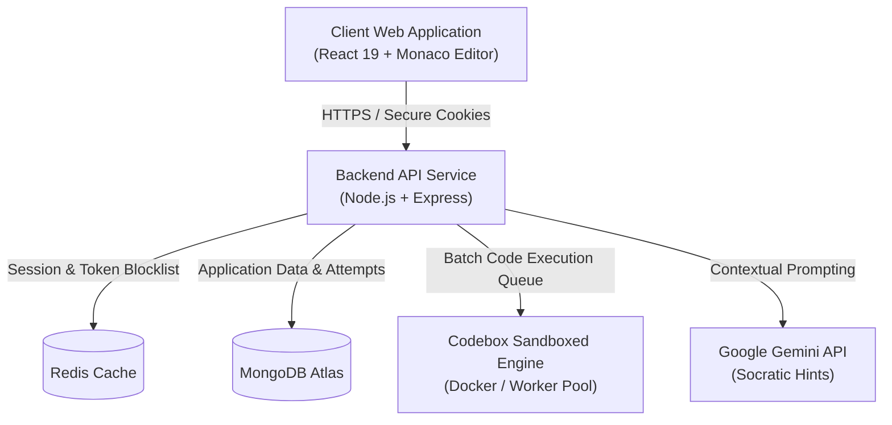

# CodeCaliber

Multi-tenant coding examination and assessment platform with sandboxed execution, real-time proctoring, and AI-assisted intuition hints.

[](https://react.dev/)
[](https://nodejs.org/)
[](https://www.mongodb.com/)
[](https://redis.io/)
[](https://www.docker.com/)
[](https://opensource.org/licenses/MIT)

## Overview

CodeCaliber is a specialized coding examination and assessment management suite designed for universities, schools, technical academies, and hiring organizations. CodeCaliber focuses on institutional assessment integrity: multi-tenant administration, question list management, timed tests with server-enforced countdowns, automated test case grading with partial credit, and live anti-cheat monitoring.

### Core Capabilities

* **Automatic AI Problem Generation**: Generates comprehensive coding problems on demand using Google Gemini based on specific topics, difficulty levels (Easy, Medium, Hard), tags, and test case counts. Automatically produces formatted problem statements, structured visible and hidden test cases, multi-language starter code templates, and reference solutions.
* **Automated Sandbox Pre-Validation Quality Gate**: Guarantees zero broken questions. Before any problem (whether AI-generated or manually authored) can be saved to the database, the backend compiles and executes the reference solution through the Codebox sandbox against every test case. If the reference solution fails, crashes, or produces incorrect output, the creation is rejected with an actionable validation error.
* **Academic Integrity and Live Proctoring**: Monitors fullscreen exits, browser window blur, and tab switching in real time. Automatically logs audit events and computes candidate risk tiers (`clean`, `suspicious`, `flagged`).
* **Sandboxed Multi-Language Execution**: Executes user code in isolated Docker containers via the Codebox worker queue, supporting C++, Python, Java, and JavaScript with strict execution timeouts and memory quotas.
* **Socratic AI Hints**: Integrates Google Gemini to deliver stepped intuition hints. The engine analyzes student code and problem context without revealing direct code solutions or leaking test answers.
* **Multi-Tenant Organization Isolation**: Strict database-level isolation ensuring that administrators, educators, question repositories, and student records remain segregated per institution.
* **Server-Enforced Timers and Auto-Finalization**: Test attempts run against server-validated deadlines. If a student closes their browser or runs out of time, their attempt is automatically graded and finalized.
* **Granular Instructor Analytics**: Educator dashboards with real-time score distributions, pass rates, question difficulty analytics, and individual student audit logs.

## Automated AI Problem Generation & Sandbox Pre-Validation

CodeCaliber solves one of the biggest challenges in coding assessment authoring: **hallucinated test cases and broken problem statements**. 



### Pre-Validation Guarantee:
1. **Multi-Language Verification**: Both manual and AI-generated reference solutions are compiled and executed inside the Codebox sandbox.
2. **Automated Header Normalization**: C++ reference solutions are checked and automatically injected with `#include <iostream>`, `#include <vector>`, and required standard libraries if omitted.
3. **Deterministic Output Matching**: Every expected output string is trimmed and verified against the actual stdout of the reference solution before any student ever touches the question.

## System Architecture



## Role and Permission Matrix

| Feature / Resource | Participant (Student) | Evaluator (Teacher) | Admin (Super Admin) |
| :--- | :---: | :---: | :---: |
| Browse public landing page & login | Yes | Yes | Yes |
| Unlock assessment via test code | Yes | No | No |
| Undertake timed assessment | Yes | No | No |
| Submit code for automated testing | Yes | Yes | Yes |
| Request AI intuition hints | Yes | No | No |
| Create / Edit / Delete questions | No | Yes | Yes |
| Generate questions via AI | No | Yes | Yes |
| Schedule & create assessments | No | Yes | Yes |
| View student performance & scores | No | Yes | Yes |
| View integrity violation audit logs | No | Yes | Yes |
| Manage educator accounts | No | No | Yes |
| Track registered platform users | No | No | Yes |

## Repository Structure

```
CodeCaliber/
|-- backend/          # Node.js and Express REST API service
|   |-- config/       # Database and Redis connections
|   |-- controllers/  # Business logic for auth, problems, submissions, tests
|   |-- middleware/   # Authentication, RBAC, and rate limiting
|   |-- models/       # Mongoose schemas (User, Problem, Test, TestAttempt, Org)
|   |-- routes/       # Express route declarations
|   `-- utils/        # AI prompting, problem validation, code parsers
|-- frontend/         # React 19 single-page client
|   |-- src/
|   |   |-- components/ # Shared UI components and route guards
|   |   |-- pages/      # Assessment, editor, admin, and dashboard pages
|   |   |-- store/      # Redux Toolkit state slices
|   |   `-- utils/      # Axios client and code utility helpers
|-- Codebox/          # Isolated Docker execution sandbox
|   |-- docker/       # Language runtime container definitions
|   `-- src/          # Queue worker, job executor, and isolation manager
|-- .gitignore        # Root git exclusions
|-- LICENSE           # MIT License
|-- package.json      # Monorepo orchestration scripts
|-- render.yaml       # Backend cloud deployment specification
`-- README.md         # Primary documentation
```

## API Reference

All requests accept and return JSON. Authenticated endpoints require an HTTP-only session cookie containing a valid JWT.

### 1. Authentication and User Management

| Method | Endpoint | Access | Description |
| :--- | :--- | :--- | :--- |
| `POST` | `/user/register` | Public | Register a new candidate account. |
| `POST` | `/user/login` | Public | Authenticate credentials and receive an HTTP-only JWT cookie. |
| `POST` | `/user/logout` | Authenticated | Invalidate current session and blocklist token in Redis. |
| `GET` | `/user/check` | Authenticated | Validate authentication state and retrieve user profile. |
| `GET` | `/user/getProfile` | Authenticated | Retrieve current user profile details. |
| `GET` | `/user/getProfile/:id` | Authenticated | Retrieve profile details for a specific user ID. |
| `POST` | `/user/admin/register` | Admin | Register an initial administrator account. |
| `POST` | `/user/evaluators` | Admin | Create an evaluator or educator account for the organization. |
| `GET` | `/user/evaluators` | Admin | List all evaluators belonging to the organization. |
| `GET` | `/user/getAllUsers` | Admin | Retrieve all users across the institution. |

### 2. Question Bank and Problem Management

| Method | Endpoint | Access | Description |
| :--- | :--- | :--- | :--- |
| `GET` | `/admin/problems` | Staff | Retrieve tenant question bank for assessment builder. |
| `GET` | `/problem/ProblemById/:id` | Authenticated | Retrieve public question statement and starter code. |
| `GET` | `/problem/admin/getProblem/:id` | Staff | Retrieve full question schema including hidden test cases. |
| `POST` | `/problem/create` | Staff | Create a new coding problem with test cases and reference solution. |
| `PUT` | `/problem/update/:id` | Staff | Update existing coding problem configuration. |
| `DELETE` | `/problem/delete/:id` | Staff | Remove a problem from the organization question bank. |
| `POST` | `/problem/ai-generate` | Staff | Generate a complete coding problem using Google Gemini. |
| `POST` | `/problem/ai-hint` | Authenticated | Request an incremental Socratic hint for a problem. |
| `POST` | `/problem/ai-explain` | Authenticated | Request an conceptual explanation of problem requirements. |
| `POST` | `/problem/ai-complexity` | Authenticated | Analyze code time and space complexity. |
| `GET` | `/problem/submittedProblem/:pid` | Authenticated | Retrieve past user submissions for a specific problem. |

### 3. Code Execution and Sandboxing

| Method | Endpoint | Access | Description |
| :--- | :--- | :--- | :--- |
| `POST` | `/submission/run/:id` | Authenticated | Run code against visible sample test cases without persisting score. |
| `POST` | `/submission/submit/:id` | Authenticated | Execute code against all test cases, grade, and record submission. |

### 4. Assessment and Examination Engine

| Method | Endpoint | Access | Description |
| :--- | :--- | :--- | :--- |
| `GET` | `/tests` | Authenticated | List accessible tests (staff see org tests; candidates see unlocked tests). |
| `POST` | `/tests` | Staff | Create a new timed assessment with marks configuration. |
| `POST` | `/tests/join` | Candidate | Unlock an assessment on the candidate dashboard using a test code. |
| `GET` | `/tests/:testId/preview` | Authenticated | Fetch pre-test lobby metadata without exposing problem questions. |
| `POST` | `/tests/:testId/start` | Candidate | Launch assessment, start candidate countdown timer, and fetch questions. |
| `PATCH` | `/tests/attempts/:attemptId/answers` | Candidate | Continuously auto-save draft code during an ongoing assessment. |
| `POST` | `/tests/attempts/:attemptId/integrity` | Candidate | Record proctoring events (`tab_switch`, `fullscreen_exit`). |
| `POST` | `/tests/attempts/:attemptId/submit` | Candidate | Finalize assessment attempt, calculate partial credit, and close attempt. |
| `PATCH` | `/tests/:testId/close` | Staff | Manually close an active assessment and move it to history. |
| `GET` | `/tests/history` | Staff | Retrieve concluded assessment history with aggregate class statistics. |
| `GET` | `/tests/:testId/performance` | Staff | Retrieve detailed evaluation dashboard, student scores, and audit logs. |

## Local Setup and Installation

### 1. Prerequisites
* Node.js (version 18 or higher)
* MongoDB (running locally on port 27017 or a MongoDB Atlas URI)
* Redis (running locally on port 6379 or a managed Redis instance)
* Docker Desktop (optional, required if running Codebox local sandboxing)

### 2. Clone the Repository
```bash
git clone https://github.com/Y45hK1r0l4/CodeCaliber.git
cd CodeCaliber
```

### 3. Backend Setup
```bash
cd backend
npm install
```

Create a `.env` file inside `backend/`:
```env
PORT=8000
MONGODB_URL=mongodb://localhost:27017/codecaliber
JWT_KEY=your_secure_jwt_secret_key
REDIS_URL=redis://localhost:6379
FRONTEND_URL=http://localhost:5173
CODEBOX_API_URL=http://localhost:3000
GEMINI_API_KEY=your_gemini_api_key
```

Start the backend service:
```bash
npm run dev
```

### 4. Frontend Setup
```bash
cd ../frontend
npm install
```

Start the frontend development server:
```bash
npm run dev
```

The application will be accessible at `http://localhost:5173`.

### 5. Codebox Sandbox Setup
```bash
cd ../Codebox
npm install
docker compose up -d
```

## License

This project is licensed under the [MIT License](LICENSE).
