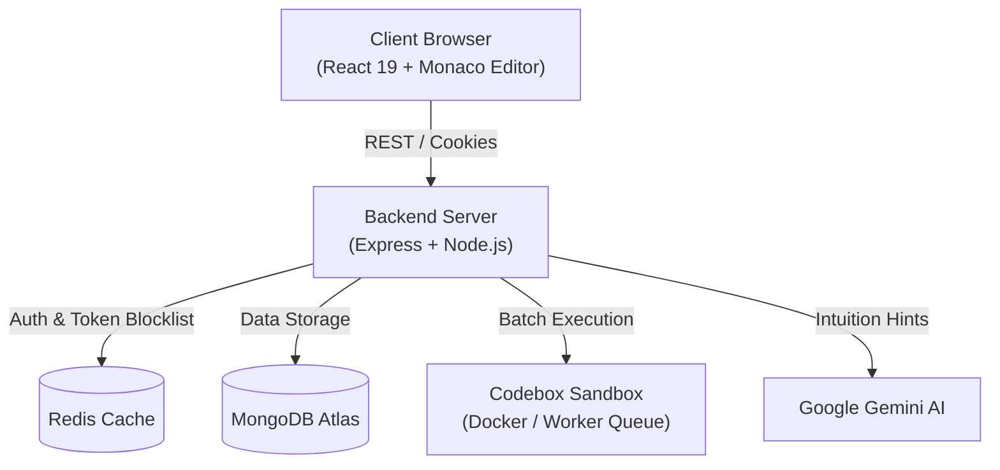

# CodeCaliber 🦅

> Enterprise-grade, multi-tenant academic coding examination & assessment platform with sandboxed execution, real-time proctoring, and AI-assisted intuition hints.

[](https://react.dev/)
[](https://nodejs.org/)
[](https://www.mongodb.com/)
[](https://redis.io/)
[](https://www.docker.com/)
[](https://opensource.org/licenses/MIT)

---

## 📖 Overview

**CodeNest** is a full-featured coding evaluation and examination suite tailored for schools, universities, coding bootcamps, and hiring teams. Unlike generic problem-solving platforms, CodeNest is purpose-built for **secure, timed examinations** with automated grading, anti-cheat detection, and institution-level multi-tenancy.

### 🌟 Key Highlights

* **🔒 Anti-Cheat & Live Proctoring**: Detects fullscreen exits, window blur, and tab switching in real-time with automatic risk-tiering (`clean`, `suspicious`, `flagged`).
* **⚡ Sandboxed Multi-Language Execution**: Isolated Docker-based code execution engine (`Codebox`) supporting C++, Python, Java, and JavaScript with strict memory & CPU limits.
* **🤖 Socratic AI Intuition Hints**: Context-aware AI hints powered by Google Gemini that guide students through problem-solving without leaking the actual code or solutions.
* **🏢 Multi-Tenant Institution Isolation**: Super admins and evaluators manage their organization's private question bank, scheduled assessments, and student rosters with complete cryptographic separation.
* **⏱️ Strict Exam Timing & Auto-Finalization**: Server-side countdown timers that automatically calculate partial marks and auto-submit assessments when time expires.
* **📊 Instructor Analytics & Audit Trails**: Real-time evaluation dashboards tracking average class scores, problem difficulty ratings, and individual student integrity event logs.

---

## 🏗️ Architecture



---

## 📂 Repository Structure

```
CodeNest/
├── backend/          # Express REST API, MongoDB models, JWT auth, and controllers
├── frontend/         # React 19 application with Vite, TailwindCSS, Monaco Editor & Redux
├── Codebox/          # Isolated Docker execution sandbox & queue worker
├── .gitignore        # Root git exclusion rules for environment and build files
├── LICENSE           # Open-source MIT License
├── package.json      # Root project scripts and workspace orchestration
├── render.yaml       # Infrastructure-as-code deployment configuration
└── README.md         # Comprehensive project documentation
```

---

## 🚀 Quick Start

### 1. Prerequisites
* **Node.js** (v18 or higher)
* **MongoDB** (Local instance or MongoDB Atlas cluster)
* **Redis** (Local or cloud Redis instance)
* **Docker** (Required for running local sandboxed execution)

### 2. Clone Repository
```bash
git clone https://github.com/Y45hK1r0l4/CodeCaliber.git
cd CodeCaliber
```

### 3. Setup Backend
```bash
cd backend
npm install
# Configure your environment variables
cp .env.example .env
npm run dev
```

### 4. Setup Frontend
```bash
cd ../frontend
npm install
npm run dev
```

### 5. Setup Codebox Sandbox
```bash
cd ../Codebox
npm install
docker compose up -d
npm start
```

---

## 🛠️ Tech Stack

| Domain | Technologies |
| :--- | :--- |
| **Frontend** | React 19, Vite, TailwindCSS, Redux Toolkit, Monaco Editor, Lucide Icons |
| **Backend** | Node.js, Express, Mongoose (MongoDB), Redis, JWT Authentication |
| **Codebox Sandbox** | Docker, BullMQ, Redis, Node.js Worker Pool |
| **AI Integration** | Google Gemini API (Socratic algorithmic intuition generator) |
| **Deployment** | Vercel (Frontend), Render (Backend), Docker Hub |

---

## 📄 License

This project is licensed under the [MIT License](LICENSE).
